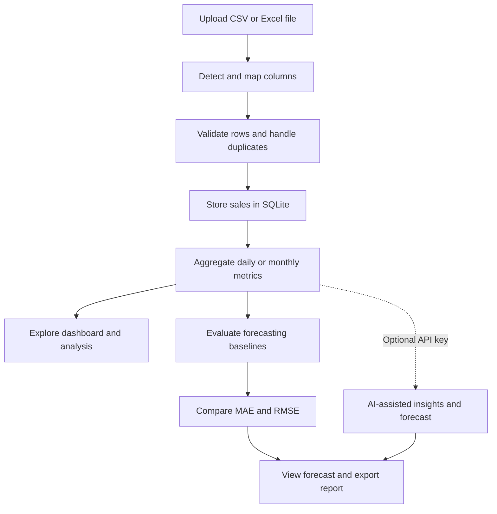

<div align="center">


# SalesCast
### Predictive Sales Forecasting & Business Analytics

**Turn historical sales into clear insights and practical short-term forecasts.**

A polished, locally runnable Flask dashboard for importing sales data, exploring trends, comparing baseline forecasting methods, and optionally generating AI-assisted insights.

<p>
  
  
  
  
</p>

[Features](#-features) · [Quick Start](#-quick-start) · [How It Works](#-how-it-works) · [Forecasting](#-forecasting-methods) · [Testing](#-run-the-tests)

</div>

---

## ✨ Overview

SalesCast is a capstone project that demonstrates an end-to-end sales analytics workflow. Import a spreadsheet or delimited text file, validate and map its columns, review daily or monthly performance, compare simple forecasting baselines, and export a report—all through one web interface.

The core analysis works locally and **does not require an API key**. An optional OpenAI API integration can add an AI-generated explanation and forecast alongside the transparent statistical baselines.

## 🚀 Features

| Area | What you can do |
|---|---|
| **Flexible imports** | Import CSV, TSV, TXT, DAT, XLSX, and XLSM files. |
| **Smart column mapping** | Automatically detect common sales columns, with a manual mapping step when needed. |
| **Data validation** | Check dates, quantities, prices, and amounts; explain invalid rows and skip duplicate records. |
| **Sales dashboard** | Review sales summaries and interactive charts for daily or monthly trends. |
| **Exploratory analysis** | Switch between line, bar, area, scatter, and pie charts; inspect revenue or units sold. |
| **Baseline forecasts** | Compare a 7-day moving average with linear regression for a configurable 1–30 day horizon. |
| **Forecast evaluation** | Use chronological holdout data and compare MAE and RMSE. |
| **Uncertainty estimate** | Display an approximate range based on holdout residuals. |
| **Optional AI insights** | Request an aggregate-data analysis and date-by-date predictions through the OpenAI API. |
| **Report export** | Download analysis data as CSV. |
| **Light and dark themes** | Switch themes with the preference retained in the browser. |
| **Automated tests** | Run tests for data processing, forecasting, API fallback, and Flask routes. |

## 🖥️ Technology Stack

- **Application:** Python, Flask, Jinja templates
- **Data processing:** Pandas, NumPy
- **Charts:** Plotly.js with a static-chart fallback
- **Database:** SQLite (`sqlite3`)
- **Optional AI integration:** OpenAI Responses API via `requests`
- **Configuration:** environment variables and `python-dotenv`
- **Testing:** pytest

## ⚡ Quick Start

### Requirements

- Python **3.10 or newer**
- `pip`
- A modern web browser
- Internet access for the initial dependency installation; optional for the AI feature

### macOS / Linux

```bash
# 1. Move into the project folder
cd "Capstone Project"

# 2. Create and activate a virtual environment
python3 -m venv .venv
source .venv/bin/activate

# 3. Install dependencies
python -m pip install --upgrade pip
pip install -r requirements.txt

# 4. Start SalesCast
python app.py
```

### Windows

1. Extract the project folder.
2. Double-click `setup_windows.bat` once to create the virtual environment and install dependencies.
3. Double-click `start_windows.bat` to launch the app.

### Open the dashboard

Visit **http://127.0.0.1:5000** in your browser. Upload the included sample file at `data/sample_sales.csv` to explore the workflow. Keep the terminal/server window open while using the app; press `Ctrl+C` to stop the development server.

## 📂 Project Structure

```text
Capstone Project/
├── app.py                    # Flask application and routes
├── forecasting.py            # Import, validation, analysis and baseline forecasts
├── ai_insights.py             # Optional AI insights and fallback behavior
├── schema.sql                 # Database schema
├── requirements.txt           # Python dependencies
├── .env.example               # Safe configuration template
├── .gitignore                 # Excludes secrets, local databases and caches
├── data/
│   └── sample_sales.csv       # Example dataset
├── templates/                 # Dashboard, analysis, mapping and forecast pages
├── static/                    # Styles and logo assets
├── tests/                     # Automated tests
├── PROJECT_GUIDE.md           # Additional project notes
├── setup_windows.bat          # Windows environment setup
├── start_windows.bat          # Windows launch script
└── test_windows.bat           # Windows test runner
```

## 🔄 How It Works



### Supported sales columns

A dataset should include a **date**, a positive whole-number **quantity**, and either a **unit price** or a **total sales amount**. If total sales is provided, unit price can be derived as `total_sales / quantity`.

Optional fields include `region`, `product_name`, and `category`. Column names can vary; the application attempts to identify common aliases and offers manual mapping when it cannot confidently match the required fields.

Example:

```csv
sale_date,quantity,unit_price,region,product_name,category
2026-01-01,12,24.50,South,Widget,Hardware
2026-01-02,9,25.00,North,Gadget,Accessories
```

## 📈 Forecasting Methods

SalesCast currently compares two intentionally interpretable baselines:

1. **7-day moving average** — uses the mean of the most recent seven training observations.
2. **Linear regression** — fits a least-squares trend over time and clips negative revenue predictions to zero.

Evaluation reserves the final chronological block as holdout data rather than randomly shuffling the time series. **MAE** summarizes average absolute error; **RMSE** penalizes larger misses more strongly. The displayed uncertainty band is an approximation based on the sample standard deviation of holdout residuals, not a guaranteed confidence interval.

These are baseline methods, not a promise of future performance. They do not explicitly model promotions, holidays, seasonality, stockouts, product mix, or external market factors. Small or inconsistent datasets may produce unreliable forecasts.

## 🤖 Optional AI Insights

To enable the optional AI feature:

1. Copy `.env.example` to `.env` in the project folder.
2. Add your own API key and select a model available to your API account:

   ```dotenv
   OPENAI_API_KEY=your_api_key_here
   OPENAI_MODEL=gpt-5-mini
   ```

3. Restart the application and open the Forecast tab.

**Security and cost notes**

- Never commit `.env` or paste your API key into source code. `.env` is excluded by `.gitignore`.
- OpenAI API usage may incur separate charges; a ChatGPT subscription does not include API usage by default.
- The integration sends aggregate daily history and baseline evaluation metrics, not raw transaction rows, according to the project implementation.
- Without a key, or if the API response is unavailable or invalid, SalesCast falls back to the best measured local baseline.
- AI outputs are estimates, not guaranteed business outcomes.

## 🧪 Run the Tests

Activate the virtual environment, then run:

```bash
python -m pytest -q
```

On Windows, you can also double-click `test_windows.bat` after setup.

The test suite covers parsing and validation, column matching, duplicate handling, aggregation, chart selection, chronological holdout evaluation, MAE/RMSE, uncertainty ranges, report downloads, AI fallback, and Flask routes.

## 🛡️ Data & Configuration Notes

- The app is designed for local development and educational use.
- The SQLite database is created locally and is intentionally excluded from version control; your database will be initialized when you run the app.
- Uploaded-file caches, Python virtual environments, generated databases, and local environment files should not be committed.
- Before deploying publicly, configure a strong secret key, review upload limits and security settings, and use a production WSGI server rather than Flask's development server.

## 🎓 Academic Context

This capstone brings together Python modules, exception handling, file processing, SQL/SQLite fundamentals, Flask routing, REST API integration, Pandas aggregation, NumPy calculations, visualization, environment configuration, and automated testing in one practical application.

## 👤 Author

**Shaik Asif** — student capstone project.

If you find a problem or have a suggestion, open an issue or submit a pull request.

---

<div align="center">

**SalesCast · From sales history to clearer decisions.**

</div>
